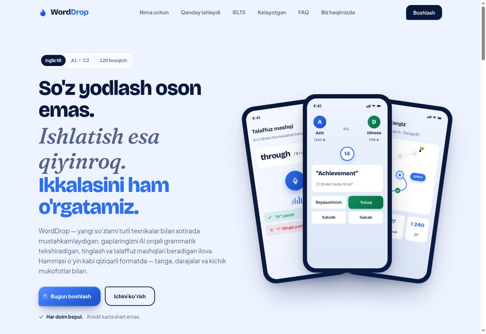
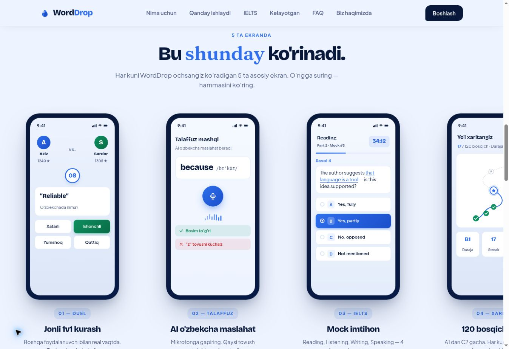

<div align="center">
  

# WordDrop

**An English-learning platform for Uzbek speakers.**

[**Live site**](https://www.worddrop-app.uz/) · [**Preview the app**](https://www.worddrop-app.uz/#how) · [**Telegram**](https://t.me/worddrop_uz)

</div>

WordDrop helps learners remember vocabulary and use it in context. The Uzbek-language interface brings together vocabulary review, grammar feedback, listening exercises, and pronunciation practice.

## Features

- **Learning roadmap** — 120 levels for structured practice from A1 through C2.
- **Vocabulary and grammar** — spaced repetition, a personal dictionary, and feedback on sentences.
- **Listening and pronunciation** — listening activities and feedback in Uzbek.
- **Exam practice** — IELTS mock tests covering Reading, Listening, Writing, and Speaking.
- **Duels** — real-time 1v1 practice.
- **Literature** — English reading practice with Uzbek translations and vocabulary support. Some study modes are part of WordDrop Pro.

## Screenshots

[](https://www.worddrop-app.uz/)

[](https://www.worddrop-app.uz/#how)

The second screenshot shows the sample screens on the public website.

## Getting started

### Preview the frontend locally

Install Git and Python 3, then run:

```bash
git clone https://github.com/yoldoshevb/worddrop.git
cd worddrop
python3 -m http.server 8000 --directory fronted
```

Open [localhost:8000](http://localhost:8000/) for the home page or [localhost:8000/app.html](http://localhost:8000/app.html) for the app entry point.

### Backend

The static preview serves the frontend. To run authenticated and server-backed features independently, you need a configured Supabase project with the app’s base database schema and settings. This repository includes the [versioned Supabase migrations](backend/supabase/migrations/) and [Edge Functions](backend/supabase/functions/). See [`.env.example`](.env.example) for configuration references. The static server does not load `.env` or apply database migrations.

## Repository structure

| Path | Contents |
| --- | --- |
| [`fronted/`](fronted/) | HTML, CSS, and JavaScript for the public website and app |
| [`backend/supabase/`](backend/supabase/) | SQL migrations and Supabase Edge Functions |
| [`backend/connector/`](backend/connector/) | WordDrop connector |
| [`content/`](content/) | Learning content |
| [`docs/`](docs/) | Project documentation and screenshots |
| [`tools/`](tools/) | Project maintenance scripts |

## Feedback and contributions

Use [GitHub Issues](https://github.com/yoldoshevb/worddrop/issues) for bug reports and feature suggestions. Include the page, the steps to reproduce the issue, and what you expected to happen. For changes, open a pull request and describe what you verified.

## License

[MIT](LICENSE)
