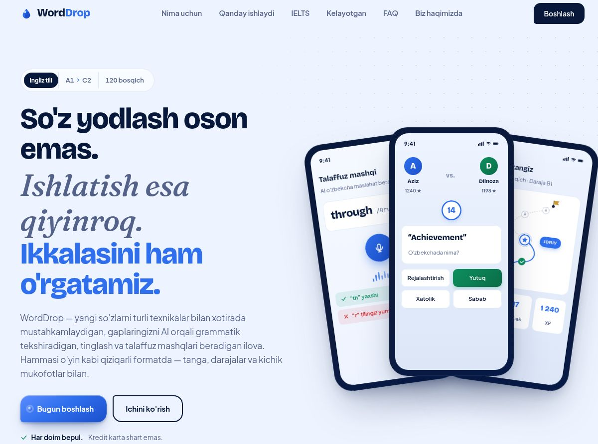
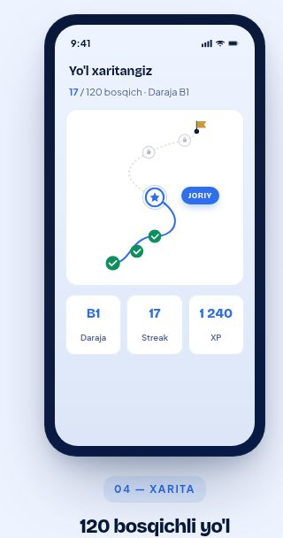
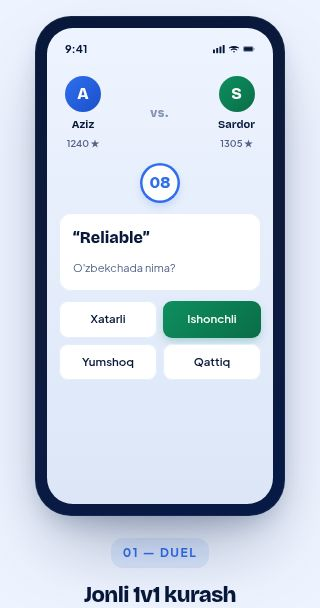
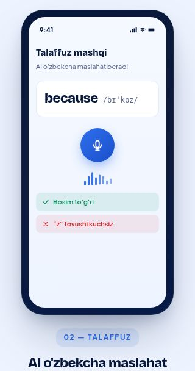
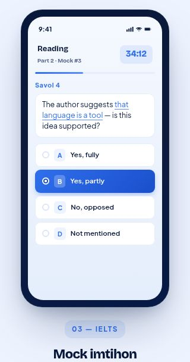
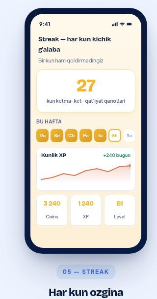
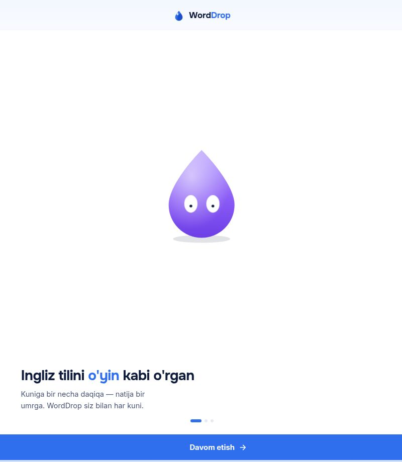
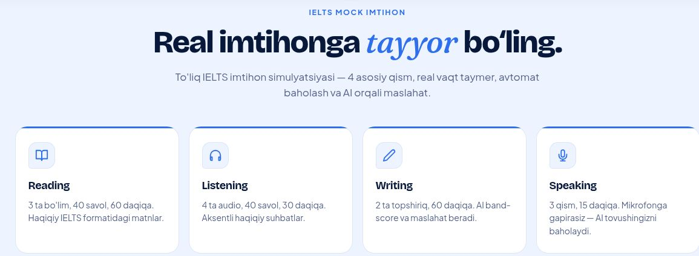
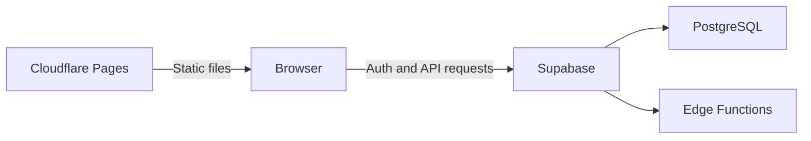

<div align="center">


# WordDrop

**English practice for Uzbek speakers.**

Vocabulary, pronunciation, exam practice, and reading in one Uzbek-language web app.

[Live site](https://www.worddrop-app.uz/) · [Screenshots](#screenshots) · [Quick start](#quick-start) · [Telegram](https://t.me/worddrop_uz)

</div>

[](https://www.worddrop-app.uz/)

## Overview

WordDrop is built around a daily practice loop. Learners review vocabulary, use it in context, and follow a 120-level A1–C2 roadmap. The interface is in Uzbek so learners can focus on practice while getting instructions and feedback in a familiar language.

| Area | What learners can do |
| --- | --- |
| **Learning roadmap** | Follow a level-based path and see what to practice next. |
| **Vocabulary and grammar** | Review vocabulary, collect words in a personal dictionary, and get feedback on written sentences. |
| **Listening and pronunciation** | Complete listening exercises and view pronunciation feedback in Uzbek. |
| **IELTS practice** | Practice Reading, Listening, Writing, and Speaking in timed mock-test sections. |
| **Duels and progress** | Play 1v1 vocabulary challenges and track daily activity through streaks and XP. |
| **Literature** | Read English works with Uzbek translations and vocabulary support. Some study modes are available through WordDrop Pro. |

## Screenshots

The gallery includes **eight captures from the live site**. The image above shows the home page. The five phone screens below are the examples shown on the [public demo page](https://www.worddrop-app.uz/#how). Click an image to open it at its original size.

<table>
<tr>
<td width="33%" align="center" valign="top">
<a href="docs/screenshots/portfolio/roadmap.jpg"></a><br>
<strong>Learning roadmap</strong><br>
<sub>The current level and the next checkpoint.</sub>
</td>
<td width="33%" align="center" valign="top">
<a href="docs/screenshots/portfolio/duel.jpg"></a><br>
<strong>Vocabulary duel</strong><br>
<sub>A timed multiple-choice challenge.</sub>
</td>
<td width="33%" align="center" valign="top">
<a href="docs/screenshots/portfolio/pronunciation.jpg"></a><br>
<strong>Pronunciation</strong><br>
<sub>Example feedback on a single word.</sub>
</td>
</tr>
<tr>
<td width="33%" align="center" valign="top">
<a href="docs/screenshots/portfolio/ielts-reading.jpg"></a><br>
<strong>IELTS Reading</strong><br>
<sub>A timed reading question with answer choices.</sub>
</td>
<td width="33%" align="center" valign="top">
<a href="docs/screenshots/portfolio/streak.jpg"></a><br>
<strong>Daily progress</strong><br>
<sub>A weekly streak, XP, and activity summary.</sub>
</td>
<td width="33%" align="center" valign="top">
<a href="docs/screenshots/portfolio/onboarding.jpg"></a><br>
<strong>Onboarding</strong><br>
<sub>The welcome screen in the live web app.</sub>
</td>
</tr>
</table>

### IELTS mock exam overview

[](https://www.worddrop-app.uz/#ielts)

## Architecture

The web frontend is served by Cloudflare Pages. The browser uses Supabase for authentication and data, and calls Edge Functions for server-side workflows.



| Layer | Implementation |
| --- | --- |
| **Web UI** | HTML, CSS, and vanilla JavaScript. The app includes a web manifest and service worker. |
| **Data and identity** | Supabase Auth and PostgreSQL, with versioned SQL migrations. |
| **Server-side workflows** | Supabase Edge Functions for selected learning and integration workflows. |
| **Hosting** | Cloudflare Pages serves the frontend from `fronted/`. |

## Quick start

### 1. Preview the frontend

With Git and Python 3 installed, run:

```bash
git clone https://github.com/yoldoshevb/worddrop.git
cd worddrop
python3 -m http.server 8000 --directory fronted
```

| Local page | What to open |
| --- | --- |
| Public landing page | [http://localhost:8000/](http://localhost:8000/) |
| App entry point | [http://localhost:8000/app.html](http://localhost:8000/app.html) |

### 2. Review backend prerequisites

The commands above start a static frontend server. An independent full-stack deployment requires a configured Supabase project, the base database schema, the applicable [migrations](backend/supabase/migrations/), and the [Edge Functions](backend/supabase/functions/) used by the features you want to run. Use [`.env.example`](.env.example) to review the expected configuration. The Python server serves the files as-is.

## Repository map

| Path | What belongs there |
| --- | --- |
| [`fronted/`](fronted/) | Landing page, web app, static assets, and Pages configuration. |
| [`backend/supabase/`](backend/supabase/) | Supabase migrations, functions, and data files. |
| [`backend/connector/`](backend/connector/) | WordDrop integration connector. |
| [`content/`](content/) | Source learning material. |
| [`docs/`](docs/) | Project documentation and screenshots. |
| [`tools/`](tools/) | Scripts for working with frontend files and audio assets. |

## Contributing

- **Report a bug.** Share the page, browser, reproduction steps, and expected behavior in [GitHub Issues](https://github.com/yoldoshevb/worddrop/issues).
- **Suggest an improvement.** Open an issue and describe the learner or developer problem it would solve.
- **Submit a change.** Open a pull request, summarize the change, and describe how you verified it.

## License

The repository ships with the [MIT license](LICENSE).
